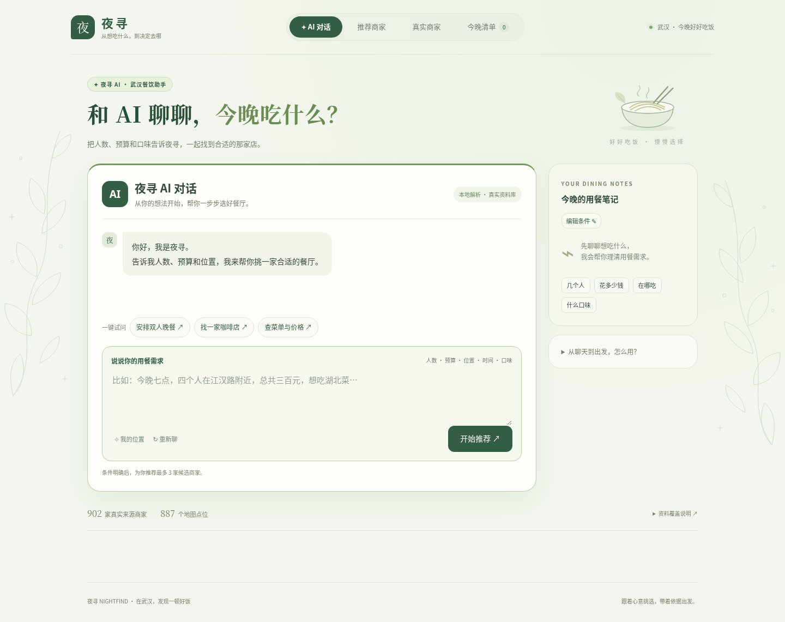
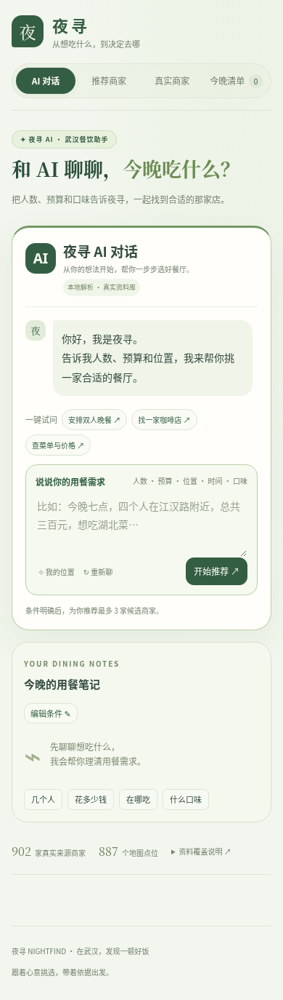

# AI 对话界面 · 2026-11-16

分支：`feature/ai-chat-focus`，基于推荐成功自动跳转版 `cbaa17d`。

## 本次调整

- 首页标题明确展示 AI 餐饮助手，顶栏 AI 对话入口使用深绿色选中态。
- 桌面聊天区占聊天与笔记总宽约 75%，增加绿色强调边框、AI 标识和清楚的聊天层次；保持淡绿色主题和两侧植物纹样。
- 放大输入框，增加可见的输入说明及人数、预算、位置、时间、口味提示；主按钮改为“开始推荐”。
- 提供“安排双人晚餐”“找一家咖啡店”“查菜单与价格”三个一键试问示例，继续使用真实商家资料响应。后续追问按钮随对话更新。
- 用餐笔记仍可编辑，使用步骤默认收起；手机优先显示对话。较矮电脑屏幕使用紧凑布局，减少装饰占用。
- 保留实际处理模式标识。推荐成功自动打开候选页，普通查询、追问及失败处理沿用已有流程。

## 检查

检查了 1440×900、1366×768、1024×768、768×1024、700×900、390×844、320×740，未出现横向溢出。常见电脑尺寸和 390 像素手机宽度的输入框与推荐按钮在首屏可见。

完整推荐跳转浏览器回归和 3 项会话存储测试通过。三个一键试问通过真实后端检查，保留条件编辑、刷新恢复、重试、收藏、对比、地图与导航功能。

页面使用原生 HTML、CSS 和 JavaScript，本次只调整前端展示及示例文案，不增加运行依赖或构建步骤。样式集中在 `static/decision.css`、`static/style.css`；页面内容在 `static/app.js` 与 `static/index.html`。

## 电脑首页

## 手机首页

