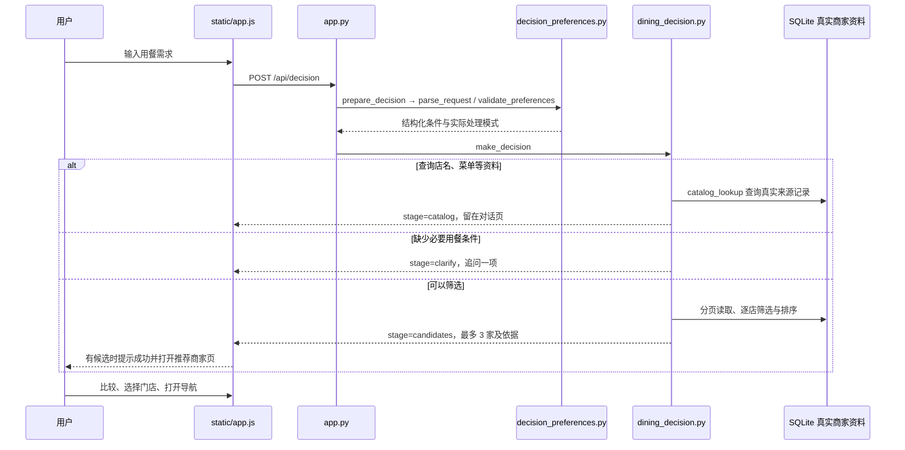

# 夜寻：完整代码阅读与修改指南

整理日期：2026-11-20。适用于 `feature/vivid-motion-code-guide`，基于 `90189bc`，包含本次醒目动效与配色调整。

这份文档按**当前实际调用的代码**说明项目，不把早期原型和历史审核记录当成当前架构。建议先运行，再沿着一次真实请求阅读。无需先学前端框架，也无需配置 AI 密钥。

配套资料：

- [全量源码汇编](SOURCE_REFERENCE.md)：逐文件收录项目自有代码、测试和配置，便于全文搜索、批注和离线学习；修改时以原始文件为准。
- [本次视觉效果与验收](VIVID_MOTION_REVIEW.md)：新配色、动画、截图与实录。
- [README](../README.md)：日常启动与使用入口。GitHub 分支的 **Code → Download ZIP** 包含完整源码、数据、地图及文档。

## 1. 先把项目运行起来

### Windows

先将 ZIP **完整解压**。进入有 `run.py` 的文件夹，在资源管理器地址栏输入 `powershell` 后回车，然后运行：

```powershell
py -3 run.py
```

也可以双击 `启动网页.bat`。如果已经打开了终端，需要先切换到实际解压目录，例如：

```powershell
cd "C:\Users\你的用户名\Downloads\nightfood-ai-feature-vivid-motion-code-guide"
py -3 run.py
```

### Mac

在终端进入实际解压目录，例如：

```sh
cd "$HOME/Downloads/nightfood-ai-feature-vivid-motion-code-guide"
python3 run.py
```

也可以输入 `python3` 和一个空格，将解压后的 `run.py` 拖进终端，再回车。启动器会自行定位项目目录。

两种系统都需要 Python 3.10+（含 SQLite）。服务就绪会打开浏览器，地址默认 `http://localhost:8000`。终端窗口要保持运行，Ctrl+C 停止。端口被占用时在启动命令后加 `--port 8001`；不自动开浏览器时加 `--no-browser`。

不要双击 `static/index.html` 来运行；页面需要通过 Python 服务访问 API。项目正常运行无需 npm、打包或第三方 Python 包。

## 2. 一次请求如何走完



浏览器组织页面、维护交互状态；Python 处理条件和筛选；SQLite 保存资料及收藏。可选 AI 只提取用户条件，不提供商家事实或代替筛选。

## 3. 全部代码文件分别做什么

### 启动、HTTP 与配置

| 文件                                  | 职责                                                                    | 阅读或修改重点                                                  |
| ------------------------------------- | ----------------------------------------------------------------------- | --------------------------------------------------------------- |
| [`run.py`](../run.py)                 | 跨平台启动器，读取 `.env`、检查端口、启动应用、等待健康检查、打开浏览器 | `load_environment`、`wait_until_ready`、`main`                  |
| [`start.sh`](../start.sh)             | 原有 Shell 启动方式                                                     | 日常优先使用 `run.py`                                           |
| [`启动网页.bat`](../启动网页.bat)     | Windows 启动入口                                                        | 调用 Python 启动器                                              |
| [`app.py`](../app.py)                 | 标准库 HTTP 服务、路由、请求校验、静态资源白名单                        | `STATIC_FILES`、`NightFindHandler`、`do_GET`、`do_POST`、`main` |
| [`.env.example`](../.env.example)     | 可选配置样例                                                            | 复制为本机 `.env` 后填写                                        |
| [`.gitignore`](../.gitignore)         | 忽略本机配置、数据库、缓存                                              | `data/` 被忽略，但三份来源 CSV 已明确纳入版本管理               |
| [`.gitattributes`](../.gitattributes) | Git 文本属性与换行规则                                                  | 跨平台协作时保留                                                |

### 当前真实商家决策链路

| 文件                                                    | 职责                                                            | 关键入口                                                                                                                |
| ------------------------------------------------------- | --------------------------------------------------------------- | ----------------------------------------------------------------------------------------------------------------------- |
| [`decision_preferences.py`](../decision_preferences.py) | 条件提取、上下文合并、输入校验、日期、位置和追问                | `DEFAULTS`、`resolve_location`、`validate_preferences`、`parse_request`、`next_question`                                |
| [`dining_decision.py`](../dining_decision.py)           | 查资料、筛选、排序、营业判断、距离、推荐解释与导航链接          | `prepare_decision`、`make_decision`、`evaluate_merchant`、`catalog_lookup`、`navigation_links`                          |
| [`decision_catalog.py`](../decision_catalog.py)         | 遍历公开门店、真实收藏、完整地图点位                            | `list_public_merchants`、`require_public_merchant`、`set_real_favorite`、`real_map_catalog`                             |
| [`real_catalog.py`](../real_catalog.py)                 | 真实门店、菜单、图片的表结构、校验、导入、公开条件与数据统计    | `initialize_real_catalog`、`import_real_merchants`、`public_real_merchants`、`catalog_coverage`、`seed_bundled_catalog` |
| [`database.py`](../database.py)                         | SQLite 连接、建表、增量迁移、旧模拟记录清理及兼容接口的数据操作 | `connect`、`initialize_database`                                                                                        |
| [`catalog_policy.py`](../catalog_policy.py)             | 来源资料与店面照片的日期范围                                    | `CATALOG_YEARS=5`、`PHOTO_YEARS=2`                                                                                      |
| [`catalog_language.py`](../catalog_language.py)         | 菜系词、品牌别名、搜索扩展、展示名称                            | `CUISINE_TERMS`、`BRAND_ALIASES`、`search_terms`                                                                        |
| [`map_services.py`](../map_services.py)                 | 可选地图配置、高德步行路线、缓存与回退                          | `public_map_config`、`walking_route`                                                                                    |
| [`geo_coordinates.py`](../geo_coordinates.py)           | WGS84 与 GCJ-02 转换                                            | `wgs84_to_gcj02`、`gcj02_to_wgs84`                                                                                      |
| [`merchant_photos.py`](../merchant_photos.py)           | 既有本地店面照片导入、格式检查、状态与公开文件读取              | `add_photo`、`approve_photo`、`public_photo_file`                                                                       |

### 前端

| 文件                                                    | 职责                                                   | 常见修改                                                    |
| ------------------------------------------------------- | ------------------------------------------------------ | ----------------------------------------------------------- |
| [`static/index.html`](../static/index.html)             | 页面骨架、主导航、两侧装饰、页脚、弹窗、脚本和样式入口 | 网站名、全局导航、装饰节点                                  |
| [`static/app.js`](../static/app.js)                     | 四个页面的状态、请求、渲染调度与事件                   | 首页文案、交互、成功跳转、失败重试、选店                    |
| [`static/decision-view.js`](../static/decision-view.js) | HTML 展示函数，不负责发请求                            | 卡片、菜单详情、对比表、条件表单、路线说明                  |
| [`static/api-client.js`](../static/api-client.js)       | 统一 GET/POST、匿名会话、20 秒超时及错误提示           | `request`                                                   |
| [`static/session-store.js`](../static/session-store.js) | 对话、草稿、条件与门店 ID 的 24 小时保存               | `loadConversation`、`saveConversation`、`clearConversation` |
| [`static/wuhan_map.js`](../static/wuhan_map.js)         | Leaflet 地图、本地底图、在线瓦片、点位、路线及视野恢复 | 对外对象 `NightFindWuhanMap`                                |
| [`static/decorations.js`](../static/decorations.js)     | 暂停、保存装饰偏好、系统减少动态效果、后台暂停         | 独立于聊天状态；无需修改推荐逻辑                            |
| [`static/style.css`](../static/style.css)               | 全局颜色变量、布局、导航、背景与植物动画、弹窗、页脚   | 配色和全局装饰集中在这里                                    |
| [`static/decision.css`](../static/decision.css)         | AI 聊天、商家卡、目录、详情、地图、表单、手机适配      | 具体功能区样式                                              |
| [`static/botanical.svg`](../static/botanical.svg)       | 植物线稿源图                                           | 当前以 CSS 遮罩着色，不需修改线稿即可换色                   |
| [`static/experience.css`](../static/experience.css)     | 早期界面样式                                           | 当前 `index.html` 没有加载它；改它不会改变当前首页          |

### 数据更新与工具

| 文件                                                      | 职责                                             | 正常启动是否需要手动运行                         |
| --------------------------------------------------------- | ------------------------------------------------ | ------------------------------------------------ |
| [`import_merchants.py`](../import_merchants.py)           | 从 CSV/JSON 校验并导入真实门店，支持 `--dry-run` | 否                                               |
| [`import_wuhan_catalog.py`](../import_wuhan_catalog.py)   | 导入随附 CSV，可选 Nominatim 补坐标              | 否；启动已自动导入随附资料                       |
| [`refresh_wuhan_catalog.py`](../refresh_wuhan_catalog.py) | 从已有公开分店页更新字段和菜单，保留证据摘要     | 否；默认只检查，`--apply` 才写入 CSV             |
| [`osm_sync.py`](../osm_sync.py)                           | OSM 获取、转换、快照校验、导入与在线采集         | 否；启动只读取已有快照                           |
| [`geofabrik_sync.py`](../geofabrik_sync.py)               | 从湖北 PBF 按武汉行政边界提取餐饮点              | 否；仅该离线采集方式额外需要 `osmium`、`shapely` |
| [`manage_osm_photos.py`](../manage_osm_photos.py)         | 既有本地店面照片命令行工具                       | 否；当前网页来源卡片不需要走人工审核才能展示     |

### 保留的早期原型代码

| 文件                                    | 当前定位                                                                                                                                            |
| --------------------------------------- | --------------------------------------------------------------------------------------------------------------------------------------------------- |
| [`services.py`](../services.py)         | 早期推荐、解析及 `chat` 实现；`app.py` 仍导入 `SCENES`，但当前 `/api/decision` 和 `/api/chat` 均调用 `dining_decision.py`，不会调用 `services.chat` |
| [`conversation.py`](../conversation.py) | 早期服务使用的多轮偏好、追问与换批辅助逻辑                                                                                                          |
| [`comparison.py`](../comparison.py)     | 兼容 `/api/compare` 的旧门店对比；当前真实商家对比走 `/api/real-compare`                                                                            |

这些文件仍有兼容接口或测试引用。本次没有为视觉修改删除或重构它们。源码里个别早期注释仍提到演示或旧审核口径，应结合实际路由、`_public_filter` 和测试阅读；例如 `import_merchants.py` 的旧提示“只有 verified 会公开”未覆盖后来加入的真实网页与 OSM 来源记录。

## 4. 建议的阅读顺序

1. 打开 `static/index.html`，认识 `#app`、导航、详情弹窗和脚本入口。
2. 在 `static/app.js` 搜索 `renderDecision`，找到首页输入框和提交事件；继续读 `sendMessage`、`runDecision`。
3. 阅读 `static/api-client.js`，观察请求如何带上 `X-Session`。
4. 在 `app.py` 找到 `/api/decision`，跟进 `prepare_decision` 和 `make_decision`。
5. 阅读 `decision_preferences.py` 的 `DEFAULTS`、`parse_request`、`next_question`，再读 `dining_decision.py` 的 `evaluate_merchant`。
6. 跟到 `decision_catalog.py`、`real_catalog.py`，理解公开记录、完整分页和来源时效。
7. 返回前端读 `showDecisionResult`、`navigate`、`decision-view.js`，理解候选如何变成页面。
8. 最后看地图、收藏、会话存储和相关测试。只改颜色时可直接从 `style.css` 开始。

提示：在编辑器中使用“转到定义”和全局搜索函数名，比从头逐行看所有历史文件更容易建立联系。

## 5. 前端状态和页面切换

`static/app.js` 的 `state` 是当前页面的主要状态：

| 字段                                   | 用途                                                                                |
| -------------------------------------- | ----------------------------------------------------------------------------------- |
| `page`                                 | `decision` 对话、`recommendations` 本轮推荐、`directory` 真实商家、`saved` 今晚清单 |
| `preferences`                          | 结构化用餐条件；每次请求仍由后端校验                                                |
| `result`                               | 最近一轮后端响应，含阶段、候选和解释                                                |
| `history`、`draft`                     | 聊天记录与尚未提交的输入                                                            |
| `busy`、`failedRequest`、`lastRequest` | 请求中状态、失败提示及重试材料                                                      |
| `saved`、`compared`、`seen`            | 收藏 ID、对比对象、已展示门店 ID                                                    |
| `selected`、`route`、`routeBusy`       | 选中的门店及路线状态                                                                |
| `mapViews`、`scrollPositions`          | 页面切换时恢复地图和滚动位置                                                        |
| `keyword`、`district`、`directoryPage` | 目录筛选与分页                                                                      |

多数按钮通过 `data-*` 标记，在 `document.addEventListener("click", ...)` 中分发。渲染函数主要在 `decision-view.js`；页面级组织与事件仍在 `app.js`。

推荐成功的判定是：**当前仍在对话页、请求属于当前页面版本、响应阶段为 `candidates` 且候选数量大于零**。通过后显示提示、切换推荐页并聚焦标题。普通资料查询、追问、空结果和失败不会自动跳转；请求期间手动切换到其他页，迟到的响应也不会把人拉回。

`session-store.js` 不缓存商家价格、地址或菜单事实，只保存条件和必要 ID，恢复时重新请求资料。装饰暂停单独使用 `nightfind-decoration-motion`，与对话存储无关。

## 6. 条件与推荐规则

### 结构化条件字典

| 字段                    | 类型或范围                         | 含义                                           |
| ----------------------- | ---------------------------------- | ---------------------------------------------- |
| `party_size`            | 整数 1–50 或 `null`                | 人数                                           |
| `budget`                | 数字 1–100000 或 `null`            | 用户明确给出的预算金额                         |
| `budget_kind`           | `total` / `per_person` / `null`    | 总预算或人均；口径不清时追问                   |
| `location`              | 对象或 `null`                      | 已识别位置；包含名称、坐标、行政区等可用信息   |
| `arrival`               | 带时区的 ISO 时间或 `null`         | 到店时间，按北京时间处理                       |
| `arrival_date_inferred` | 布尔                               | 是否只给时间、日期由系统暂按今天解释           |
| `cuisine`               | 最多 40 字符                       | 菜系偏好，空字符串表示不限                     |
| `avoid`                 | 最多 10 项的字符串数组             | 忌口或过敏信息                                 |
| `radius_km`             | 数字 0.1–100 或 `null`             | 直线距离上限，不是道路距离                     |
| `wait_minutes`          | 整数 0–180 或 `null`               | 用户可接受等待；无实时排队数据时只能提示待确认 |
| `priority`              | `balanced` / `distance` / `budget` | 均衡、距离优先、价格优先                       |
| `provenance`            | 对象                               | 字段来自 `user`、`inferred` 或 `device`        |

`resolve_location` 支持已配置商圈、武汉行政区、本地底图地铁站、浏览器主动提供的坐标；不会通过模型猜坐标。只说时间时按北京时间解析，过去的到店时间需要重新确认。

### 推荐过程

1. `catalog_lookup` 先识别直接资料查询；这类查询不要求先填写全部用餐条件。
2. 用餐规划走 `next_question`，缺少关键条件时逐项追问。
3. `list_public_merchants` 遍历公开目录的所有分页，而不是仅取第一页。
4. `evaluate_merchant` 排除已知超预算、超距离、到店时不营业或与忌口冲突的记录。
5. 缺少可靠价格、营业时段等信息时保留“待确认”，不当成已经满足条件。
6. 排序先考虑待确认项数量，再按偏好、距离、参考价格等排序；最后按 ID 保持稳定。不制造评分。
7. 保留指定候选、排除已见记录后最多取三家，再加载具体菜单与图片证据。

总预算会按人数换算人均。菜品单价不等于人均价；只有明确的人均参考口径才参与预算上限判断。直线距离不等于步行距离；营业来源不等于实时营业状态。

## 7. HTTP 接口索引

JSON 请求统一使用 `Content-Type: application/json`。所有 POST 以及读取个人收藏时需要 `X-Session`；允许 1–80 位字母、数字和连字符。它是匿名访问者标识，不是登录账户。请求体上限 20000 字节，需求文字 1–2000 字符。

### 当前页面使用的接口

| 方法与路径                         | 输入                                     | 主要返回 / 用途                                          |
| ---------------------------------- | ---------------------------------------- | -------------------------------------------------------- |
| `GET /api/health`                  | 无                                       | `status`、`app`；启动健康检查                            |
| `GET /api/map-config`              | 无                                       | 地图服务配置、是否支持站内步行路线；不返回高德服务端密钥 |
| `POST /api/decision`               | 需求、条件上下文等，见下例               | 追问、资料查询或候选推荐                                 |
| `POST /api/chat`                   | 与 `/api/decision` 相同                  | 当前指向相同真实商家决策逻辑                             |
| `GET /api/real-merchants`          | `keyword`、`district`、`limit`、`offset` | `items`、`total`；默认每页 30，最多 100                  |
| `GET /api/real-merchants/{id}`     | 门店 ID                                  | 一家公开门店及菜单、图片、来源等详情                     |
| `GET /api/real-merchants/coverage` | 无                                       | 来源、坐标、菜单单价等覆盖统计                           |
| `GET /api/real-map`                | `keyword`、`district`                    | 完整筛选下有坐标的点位，不受列表分页影响                 |
| `GET /api/real-favorites`          | `X-Session`                              | 当前匿名访问者的真实门店收藏                             |
| `POST /api/real-favorites`         | `merchant_id`、`active` 布尔             | 设置收藏状态                                             |
| `GET /api/real-compare`            | `ids=1,2`；用实际 ID 替换                | 真实商家对比；要求 2–3 个不同 ID                         |
| `POST /api/walking-route`          | `merchant_id`、`origin` 坐标对象         | 真实服务路线，或外部地图回退说明                         |
| `GET /real-photo/{id}`             | 照片 ID                                  | 满足既有公开条件的本地店面照片                           |

### 保留的兼容接口

| 接口                                                          | 当前作用                                  |
| ------------------------------------------------------------- | ----------------------------------------- |
| `GET /api/bootstrap`                                          | 早期商圈、收藏与 AI 是否配置的信息        |
| `GET /api/merchants`、`GET /api/merchants/{id}`               | 旧 `restaurants` 表读取；不是当前真实目录 |
| `GET /api/favorites`、`POST /api/favorites`、`GET /api/saved` | 旧收藏                                    |
| `GET /api/compare`                                            | 旧门店对比                                |
| `GET /api/reviews`                                            | 旧反馈汇总与近期记录                      |
| `GET /api/suggestions/summary`、`POST /api/suggestions`       | 早期建议入口                              |
| `POST /api/feedback`                                          | 旧门店反馈                                |

保留接口不表示当前导航展示了这些功能。对真实商家做修改时使用带 `real-` 的接口和当前决策入口。

### 用浏览器检查一次真实请求

在运行中的页面按 F12，打开 Console，执行：

```js
const response = await fetch("/api/decision", {
  method: "POST",
  headers: {
    "Content-Type": "application/json",
    "X-Session": "learning-session",
  },
  body: JSON.stringify({
    message: "明天晚上七点，两个人在江汉路附近，总预算400元，想吃湖北菜",
    context: {},
    seen_ids: [],
    keep_ids: [],
    previous_ids: [],
  }),
});
const result = await response.json();
console.log(result);
```

这会调用真实后端，不直接更改前端 `state`。观察 Network 面板可以检查页面自己提交时的请求和响应。

响应主要字段：`stage`（`clarify` / `catalog` / `candidates`）、`constraints`、`budget_per_person`、`mode`（`local` / `ai` / `fallback`）、`reply`、`items`、`follow_up`、`eligible_total`、`excluded`、`exhausted`。不同阶段还会附加对应信息；以实际响应为准。

编辑用餐笔记时发送 `intent: "plan"` 和 `preferences` 对象，直接校验条件并筛选；不要同时把它当作自然语言重新提取。继续聊天通常发送上一轮 `constraints` 作为 `context`。

## 8. 数据库与来源文件

默认数据库为 `data/night.db`，首次启动生成；源码包不包含你本机的数据库或收藏。`APP_DB` 可指定另一个库。修改表结构应使用增量迁移，避免为了新增字段删除旧库。

### 当前链路使用的表

| 表                            | 内容与关系                                                     |
| ----------------------------- | -------------------------------------------------------------- |
| `real_merchants`              | 门店主表；`id` 是内部 ID，`external_id` 是来源唯一 ID          |
| `real_merchant_menu_items`    | 菜品、单价、单位、价格来源及日期；`merchant_id` 关联门店       |
| `real_merchant_images`        | 来源图片链接、图片类型、说明、作者、许可、日期；可为菜品参考图 |
| `real_merchant_photos`        | 既有本地店面照片流程，含文件名、拍摄日期、权利信息及状态       |
| `real_favorites`              | `(session_id, merchant_id)` 联合主键，隔离匿名收藏             |
| `sessions`                    | 匿名访问者记录，被收藏等表引用                                 |
| `real_catalog_seed_state`     | 随附 CSV 文件摘要，用于检测资料变化                            |
| `catalog_import_state`        | OSM 导入来源摘要与导入时间                                     |
| `real_merchant_geocode_cache` | 地址补坐标查询缓存                                             |

保留的兼容表：`districts`、`restaurants`、`hours`、`dishes`、`recommendation_runs`、`recommendation_items`、`favorites`、`surveys`、`feedback`、`events`、`suggestions`。正常启动默认 `include_demo=False`，不会生成模拟餐厅；已识别的旧模拟记录会在备份后清理。

### 门店字段怎样理解

| 字段组                                                                                 | 说明                                                                                     |
| -------------------------------------------------------------------------------------- | ---------------------------------------------------------------------------------------- |
| `name`、`district`、`address`、`phone`、`cuisine`、`signature_dishes`、`opening_hours` | 来自具体来源的门店资料；缺失不猜填                                                       |
| `latitude`、`longitude`                                                                | 项目统一保存 WGS84；传给外部高德服务前转换                                               |
| `price_per_person`                                                                     | 来源明确的人均参考值                                                                     |
| `price_range_min`、`price_range_max`、`price_range_basis`                              | 区间及口径；只有 `per_person` 可按人均预算处理                                           |
| `source_name`、`source_url`、`evidence_url`                                            | 来源身份与证据链接                                                                       |
| `source_published_at`                                                                  | 原文发布日期（已知时）                                                                   |
| `source_checked_at`                                                                    | 来源信息检查日期                                                                         |
| `source_collected_at`                                                                  | 在线采集日期                                                                             |
| `source_archived_at`                                                                   | 快照归档日期，不是逐店调查日期                                                           |
| `source_updated_at`                                                                    | 来源元素更新时间，不是门店营业保证                                                       |
| `verified_at`、`verification_method`、`status`                                         | 既有核验与状态信息；真实网络来源可按公开条件展示，不要求先人工审核                       |
| `data_quality`                                                                         | 查询时生成的质量类型：`verified`、`community`、`web_listing`；不是数据库中需要手动填的列 |

公开范围由 `real_catalog.py` 的 `_public_filter` 和 `catalog_policy.py` 控制：符合日期等要求的 verified 记录、OSM 来源 pending 记录、指定真实网页来源 pending 记录均可显示。

### 随仓库分发的资料

| 路径                                        | 用途与当前数量                                 |
| ------------------------------------------- | ---------------------------------------------- |
| `data/wuhan_restaurants.csv`                | 68 条网页来源门店记录                          |
| `data/wuhan_menu_items.csv`                 | 362 条菜单记录；通过 `external_id` 对应门店    |
| `data/wuhan_restaurant_images.csv`          | 55 条图片关联记录，须保留图片类型、作者与来源  |
| `data_sources/osm_wuhan_snapshot.json`      | 834 条 OSM 历史归档记录                        |
| `data_sources/osm_wuhan_snapshot.meta.json` | 归档日期、条数、摘要和来源提交；与快照配套校验 |
| `data_sources/wuhan_web_refresh.json`       | 分店页更新证据及原页面摘要                     |
| `static/map/wuhan-basemap.geojson`          | 武汉行政边界、道路、水域、地铁站及地名         |
| `static/map/wuhan-basemap.meta.json`        | 底图来源、数量、坐标系和摘要                   |

截至本次全新初始化：公开来源记录 902 条，有坐标点位 887 个；74 条带来源单品价格，覆盖 21 家门店。记录可能指向同一实体门店，数量不是独立在营门店保证。详细覆盖以 `/api/real-merchants/coverage` 为准；本次视觉修改没有重新联网采集数据。

查看库内容的简单方法：

```python
import sqlite3

with sqlite3.connect("data/night.db") as db:
    for row in db.execute(
        "SELECT id, name, address FROM real_merchants ORDER BY id LIMIT 10"
    ):
        print(row)
```

在项目目录运行此代码。修改来源 CSV 后重启会按文件摘要检测变化；修改数据库已有记录和修改随附 CSV 是两种不同更新方式，学习时先用备份库试验。

## 9. 地图怎样显示

`static/wuhan_map.js` 先绘制本地 GeoJSON，再尝试在线街道瓦片。配置 `TIANDITU_KEY` 时先用天地图，失败尝试 OSM；在线层不可用时保留本地真实地理简图。Leaflet 库在 `static/vendor/leaflet/`，正常运行不需要从 CDN 下载库。

商家地图点位来自 `/api/real-map`，列表分页不会截断地图。点位点击与列表卡片通过同一门店 ID 关联。菜单、收藏、对比和导航也使用该 ID。

站内步行路线只在用户点击后请求：后端 `map_services.py` 调用高德，转换坐标、返回真实路线及服务给出的距离和用时。没有 `AMAP_WEB_KEY` 时提供外部导航，不合成步行路线。`geo_coordinates.py` 集中处理 WGS84 / GCJ-02，避免图上偏移。

## 10. 配置与手动数据工具

### 配置变量

| 变量                 | 默认 / 作用                                                             |
| -------------------- | ----------------------------------------------------------------------- |
| `PORT`               | `8000`；`run.py --port` 优先                                            |
| `APP_DB`             | 项目内 `data/night.db`                                                  |
| `OPENAI_API_KEY`     | 空；留空使用本地解析                                                    |
| `OPENAI_MODEL`       | `gpt-5.5`；启用 AI 时换成自己账户可用模型                               |
| `OPENAI_BASE_URL`    | `https://api.openai.com/v1/responses`；兼容 Responses 的完整 HTTPS 端点 |
| `TIANDITU_KEY`       | 空；可选浏览器街道地图 Key                                              |
| `AMAP_WEB_KEY`       | 空；可选后端步行路线服务 Key                                            |
| `MERCHANT_PHOTO_DIR` | `data/merchant_photos`；既有本地照片存储目录                            |

`run.py` 读取 `.env`，已有进程环境变量优先；`.env` 只按 `KEY=value` 解析，不执行 Shell。直接运行 `app.py` 不会自动读取 `.env`。改配置和 Python 后端代码后需重启。CSS/JS 修改后刷新即可，必要时 Ctrl+Shift+R 强制刷新。

### 按需要选择的工具

```sh
# 校验自己的门店 CSV/JSON，不写入门店记录
python3 import_merchants.py path/to/merchants.csv --dry-run

# 导入随附目录；正常启动已会完成
python3 import_wuhan_catalog.py

# 检查公开分店页面；不带 --apply 不写回 CSV
python3 refresh_wuhan_catalog.py --limit 10

# 明确需要更新来源时才运行：写入更新结果
python3 refresh_wuhan_catalog.py --apply --limit 50 --discover

# 在线获取至少 100 条 OSM 来源记录；失败不会用虚假数据覆盖
python3 osm_sync.py fetch --minimum 100
```

在线采集需要能连接对应来源。`geofabrik_sync.py` 是另一个离线提取工具，会下载湖北数据，且需要额外采集依赖；它不属于日常启动步骤。`manage_osm_photos.py --help` 可以查看既有照片工具的 `add`、`approve`、`reject`、`list` 参数，本次没有扩展该流程。

## 11. 常见修改：最少改哪些地方

### 改配色

修改 `static/style.css` 顶部 `:root`，例如 `--page` 为页面基础色、`--surface` 为卡片底色、`--green-deep` 为深绿、`--accent` 为青柠强调色。动画渐变的具体颜色在同文件装饰区。若要同步手机浏览器工具栏颜色，修改 `index.html` 的 `theme-color`。

### 调整动效强度

同文件搜索以下名称：

| 名称 / 位置                        | 控制内容                     |
| ---------------------------------- | ---------------------------- |
| `ambient-flow`                     | 大片背景光晕移动、缩放和明暗 |
| `botanical-sway`                   | 两侧线稿的摇摆角度与位移     |
| `botanical-drift`                  | 大叶片飘落距离与旋转         |
| `--leaf-duration`、`--leaf-delay`  | 各叶片的时长和错峰           |
| `botanical-twinkle`                | 金色光点上浮与明暗           |
| `botanical-breathe`                | 椭圆光环移动、摆动、缩放     |
| `.side-botanical` 的宽、高、透明度 | 两侧装饰面积和可见程度       |

时长越短越快；角度、位移越大越明显。只调整 CSS 即可，无需加动画库、计时器或画布。暂停逻辑仍由 `decorations.js` 统一处理；手机保留背景光晕并可暂停。

### 改首页文字和试问

在 `static/app.js` 的 `renderDecision` 修改标题、欢迎语和 `suggestions`。按钮的 `label` 是显示文字，`message` 是实际发送的需求，应同时检查。不要在这里写死推荐商家或价格。

### 改卡片与详情

在 `static/decision-view.js` 找 `merchantCards`、`detailsView`、`comparisonView`。布局样式改 `decision.css`。若要新增资料字段，还需检查 CSV 导入、数据库增量迁移、公开查询字段及 `describe_merchant`，不能只在前端添加一个名称。

### 改筛选和排序

修改 `dining_decision.py` 的 `evaluate_merchant`。排除条件返回 `(None, 原因)`；可用候选返回 `(item, None)`。`reasons` 是依据，`questions` 是待确认项，`_order` 是内部排序键，不直接展示给用户。用 `tests/test_decision.py` 验证新规则。

候选“最多三家”是多处共同约定。若以后修改数量，需要同步 `make_decision`、`catalog_lookup`、上一轮候选校验、前端说明、对比数量规则及相关测试，不建议只把一个 `[:3]` 改掉。

### 加一个位置别名

修改 `decision_preferences.py` 的 `LANDMARKS` 或 `resolve_location`，保持使用有依据的 WGS84 坐标。地铁站已经来自本地底图，无需重复写入。加入对应解析测试，检查地图和直线距离。

### 加静态文件或 API

新增 CSS/JS 要放到 `static/`，在 `app.py` 的 `STATIC_FILES` 注册访问路径，并在 HTML 或已有模块中引用。后端不是通用静态目录服务器，单独放进去不会自动可访问。

新增 API 时由 `app.py` 做请求解析与错误处理，具体规则放到对应模块；前端继续通过 `api-client.js` 的 `request` 调用。无需为小功能另起一个框架或服务。

## 12. 测试、工作流与检查顺序

### 自动测试文件索引

| 文件                                  | 主要覆盖                                                             |
| ------------------------------------- | -------------------------------------------------------------------- |
| `tests/test_app.py`                   | 早期数据库与服务基础行为                                             |
| `tests/test_experience.py`            | 早期多轮偏好、换批、对比等兼容行为                                   |
| `tests/test_http.py`                  | HTTP 请求、会话、参数和错误处理                                      |
| `tests/test_decision.py`              | 当前条件解析、筛选、追问、查询、导航与 HTTP 链路                     |
| `tests/test_real_catalog.py`          | 门店导入、公开条件、菜单与图片来源                                   |
| `tests/test_real_catalog_workflow.py` | 五年证据、快照校验、模拟清理、地图全量点位及真实查询                 |
| `tests/test_catalog_refresh.py`       | 分店网页解析、坐标、单品价和分店一致性                               |
| `tests/test_osm_sync.py`              | OSM 转换、日期、来源和导入                                           |
| `tests/test_osm_photos.py`            | 既有照片格式、权利信息、时效与公开读取                               |
| `tests/test_map_services.py`          | 坐标转换、路线解析、缓存及回退                                       |
| `tests/session_store.test.mjs`        | 对话保存、过期、无存储支持和避免缓存门店事实                         |
| `tests/recommendation_navigation.cjs` | 真实服务下推荐成功跳转、失败重试、编辑条件、卡片操作、刷新与手机布局 |
| `tests/decorative_motion.cjs`         | 实际运动、镜像、所有装饰层暂停、减少动态效果、无存储支持及屏幕宽度   |

Mac / Linux：

```sh
python3 -m unittest discover -s tests -v
node tests/session_store.test.mjs
```

Windows：

```powershell
py -3 -m unittest discover -s tests -v
node tests/session_store.test.mjs
```

Python 测试使用标准库。Node 只用于开发检查，不是启动应用的依赖。浏览器脚本额外需要开发环境已有 Playwright 和 Chromium；服务启动后可运行：

```sh
CHROMIUM_PATH=/usr/bin/chromium node tests/decorative_motion.cjs http://127.0.0.1:8000
CHROMIUM_PATH=/usr/bin/chromium node tests/recommendation_navigation.cjs http://127.0.0.1:8000
```

上例为 Linux 浏览器路径。Windows PowerShell 需先用 `$env:CHROMIUM_PATH="实际的浏览器路径"` 设置，再执行 `node ...`；Playwright 已有自带浏览器时可不设置该变量。

GitHub 工作流：

- [`.github/workflows/tests.yml`](../.github/workflows/tests.yml)：feature/fix/redesign 分支推送及相应 PR 时检查 Python、JavaScript 语法和 Python 测试。
- [`.github/workflows/osm-collect.yml`](../.github/workflows/osm-collect.yml)：手动触发 OSM 获取，结果保存为下载产物；不会自动提交或推送。

浏览器脚本和 Node 会话测试目前不在上述 Python 工作流里，需在开发环境单独执行。按修改范围做检查：配色和布局重点看实际浏览器；条件规则重点跑对应 Python 测试；API 或跨模块改动再检查完整流程。

## 13. 当前边界与排查

| 看到的情况                   | 原因与检查位置                                                |
| ---------------------------- | ------------------------------------------------------------- |
| `can't open file ... run.py` | 终端不在项目目录；按第 1 节切换目录，或使用 `run.py` 完整路径 |
| 提示端口不可用               | 旧服务仍在运行或端口被占用；停止旧服务或加 `--port 8001`      |
| 界面显示“本地解析”           | 未配置 AI 密钥时的正常模式，仍查真实库                        |
| 界面显示 AI 回退             | 检查模型、完整 HTTPS 端点及网络；请求失败会自动用本地解析     |
| 商家价格、电话、营业时间未知 | 现有来源缺少数据；不要把别的分店或菜品单价补作该店人均        |
| 地图没有在线街巷细节         | 在线瓦片不可用时保留本地地理简图；不会据此编造道路路线        |
| 没有站内步行用时             | 需配置高德 Web 服务 Key；未配置时使用外部导航                 |
| 动效不动                     | 查看页脚是否暂停、系统是否减少动态效果、页面是否在后台        |
| 小屏没有两侧植物             | 宽度不超过 1100 像素时主动收起；背景光晕仍保留                |
| 改 `experience.css` 无变化   | 当前 HTML 没有加载这个历史文件                                |
| 新 JS/CSS 返回 404           | 检查 `STATIC_FILES` 注册路径和 HTML 引用                      |
| CSV 有新内容但页面未更新     | 重启服务触发摘要导入，检查字段校验、来源日期及公开条件        |

目前是本地运行的决策原型：没有账号登录、在线支付、自建预订、实时排队或实时营业验证。真实来源记录不等于独立门店数，也不保证现在仍营业。当前桌面视觉主要适配 Chromium、Edge、Safari 等现代浏览器。

## 14. 其他文档与第三方文件

| 文档或目录                                                 | 内容                                                             |
| ---------------------------------------------------------- | ---------------------------------------------------------------- |
| [VIVID_MOTION_REVIEW.md](VIVID_MOTION_REVIEW.md)           | 本次醒目视觉与验收                                               |
| [BOTANICAL_MOTION_REVIEW.md](BOTANICAL_MOTION_REVIEW.md)   | 前一版柔和动效的历史说明                                         |
| [AI_CHAT_REVIEW.md](AI_CHAT_REVIEW.md)                     | AI 对话首页强化版的历史说明                                      |
| [RECOMMENDATION_REVIEW.md](RECOMMENDATION_REVIEW.md)       | 推荐成功提示与自动跳转的历史说明                                 |
| [UI_REVIEW.md](UI_REVIEW.md)                               | 2026-11-06 数据补充、可编辑条件及地图版说明                      |
| [OSM_FRESHNESS_PHOTOS_MAP.md](OSM_FRESHNESS_PHOTOS_MAP.md) | 早期来源、照片与地图方案记录；当前行为以代码和本指南为准         |
| [data_sources/README.md](../data_sources/README.md)        | 数据来源、导入及署名                                             |
| [static/map/README.md](../static/map/README.md)            | 底图来源、坐标系、精度和更新方法                                 |
| `docs/previews/`                                           | 各版截图和实录；不参与应用运行                                   |
| `static/vendor/leaflet/`                                   | 随附 Leaflet JS、CSS、标记图片；第三方代码不建议作为入门修改对象 |
| [Leaflet LICENSE](../static/vendor/leaflet/LICENSE)        | BSD-2-Clause 许可；与地图数据的 ODbL 署名分开保留                |

`SOURCE_REFERENCE.md` 是本次代码的阅读快照，不是应用入口。今后修改原始代码后，它不会自动同步；以 Git 提交中的原始文件为准。完整源码 ZIP 保留全部第三方文件、CSV、JSON、地图、截图及文档，汇编则省略这些大体积数据和第三方压缩代码。
