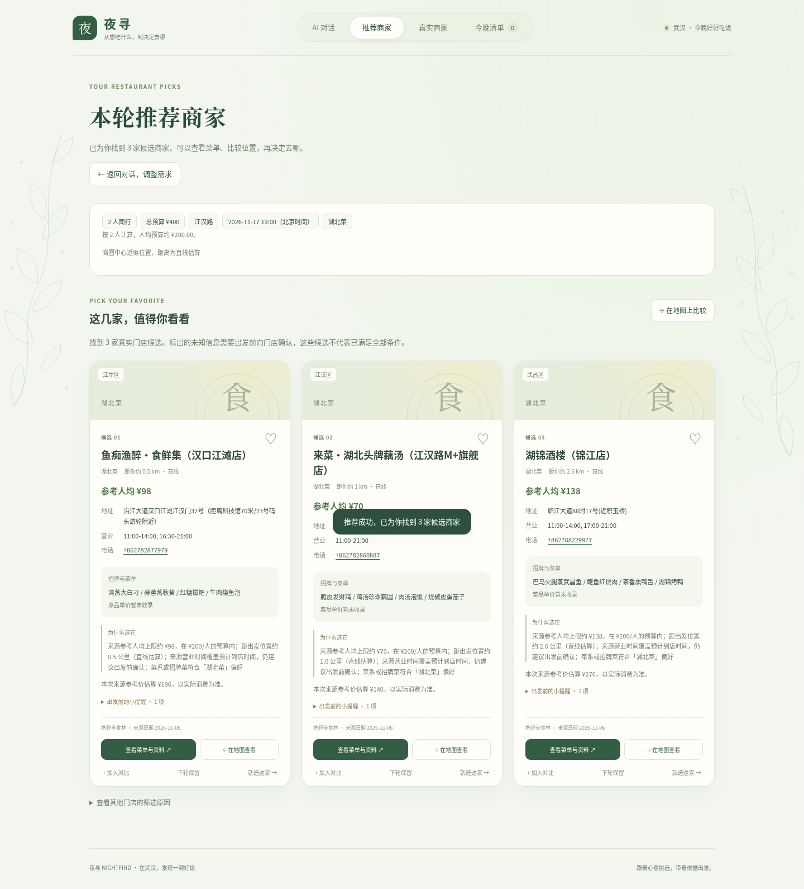
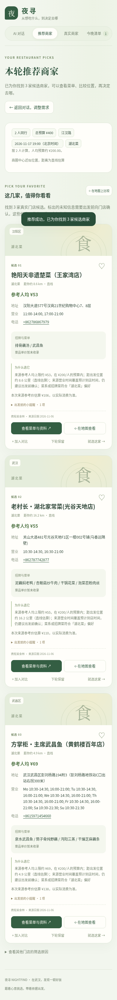

# 推荐成功提示与自动跳转 · 2026-11-16

分支：`feature/recommendation-success-page`。基于前一版 `cba3463`，本次集中修改前端交互，复用已有商家卡片与地图，不增加运行依赖或构建步骤。

## 改动

- 自然语言需求得到非空候选后，弹出“推荐成功，已为你找到 N 家候选商家”，自动打开独立的“本轮推荐商家”页。
- 右侧编辑条件后点击“保存并重新筛选”，成功时使用相同的提示与跳转流程。
- 推荐页展示本次条件、接口实际返回的候选、推荐依据和来源资料，保留详情、收藏、对比、地图、下轮保留及选择餐厅功能。
- 顶栏新增“推荐商家”入口，页面提供“返回对话，调整需求”；对话和条件保留。刷新时重新查询资料，仍有效的候选可恢复在推荐页，不重复弹出成功提示。
- 修复旧解析将“便宜一点”“找近一点”误当作凌晨一点的问题，保持原有到店时间并按偏好重新推荐。
- 追问、普通资料查询、空结果和失败保留对话页面。失败后可重试，只有实际拿到候选才显示成功。用户等待期间已切换页面时，不强制拉回。

## 手动验收

1. 启动 `python3 run.py`，输入“明天晚上七点，两个人在江汉路附近，总预算400元，想吃湖北菜”。应出现成功提示并自动打开本轮候选。
2. 检查页面上的候选数量与提示一致，尝试详情、地图、收藏、对比和选择一家餐厅。
3. 返回对话，点击“编辑条件”，修改预算并保存；筛选成功后再次自动打开推荐页。
4. 刷新推荐页，应重新读取资料并恢复有效候选；返回对话可继续聊天。
5. 单独问“查金贵源的菜单价格”应继续在对话中展示资料；需求不完整、无候选或连接失败时，不显示推荐成功。

## 验证

92 项后端及 HTTP 回归、3 项会话存储测试通过，新增浏览器流程也已通过。浏览器使用真实数据库查询，外部图片和在线瓦片被阻断时仍可使用本地武汉底图。

新增可选浏览器回归文件是 `tests/recommendation_navigation.cjs`。先启动应用，在有 Playwright 与 Chromium 的开发环境中执行：

```sh
node tests/session_store.test.mjs
node tests/recommendation_navigation.cjs http://127.0.0.1:8000
```

如使用系统 Chromium，可设置 `CHROMIUM_PATH` 指向它；测试使用的 Playwright 不属于应用运行依赖。浏览器检查覆盖成功跳转、候选 ID 一致、追问与查询、空结果、失败及重试、条件编辑、刷新、返回历史、卡片操作、延迟响应不打断浏览，以及手机和平板宽度。

## 桌面效果



## 手机效果


