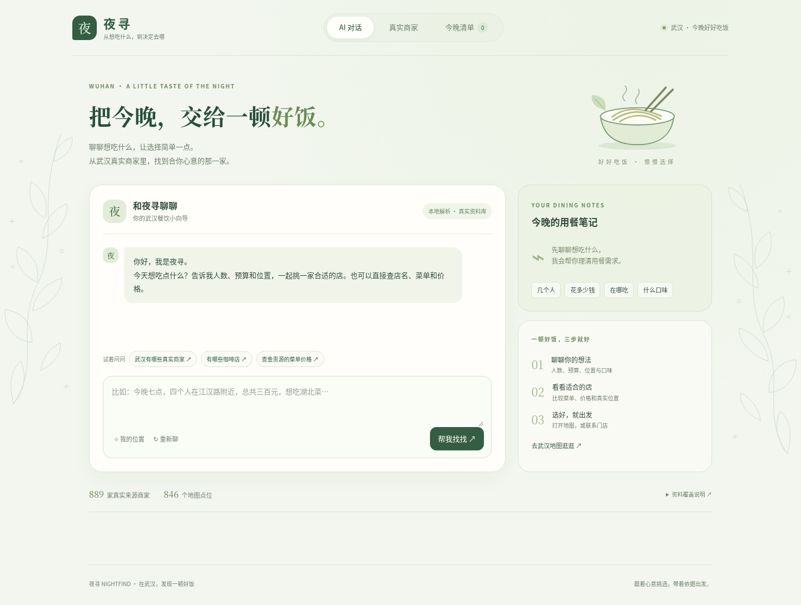
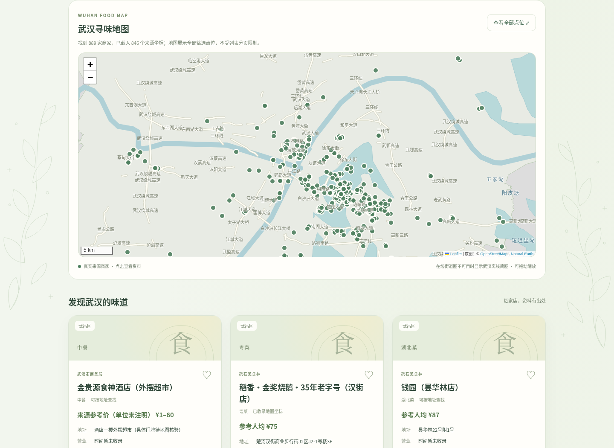
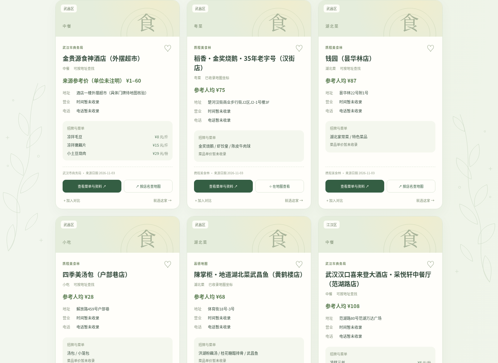
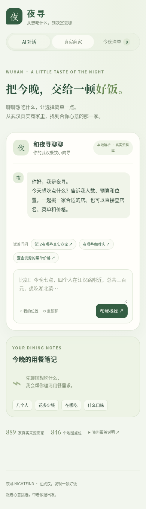

# 本版审核说明

本次在 `feature/wuhan-map-card-refresh` 分支上完善资料卡、武汉地图和淡绿色界面，保持 Python 标准库、SQLite 与原生 JavaScript，不新增运行依赖或前端构建步骤。

## 建议检查

1. 在项目文件夹中启动 `py -3 run.py`（Windows），浏览器会自动打开。若 Windows 拦截批处理文件，直接在终端运行上述 Python 命令即可。
2. 在 AI 对话输入“查金贵源的菜单价格”，检查菜单条目、单价及来源；也可填写人数、预算和位置获取候选。
3. 进入“真实商家”，在武汉地图中拖动、缩放、点击点位；卡片的“在地图查看”应聚焦对应分店。
4. 查看完整资料，尝试收藏、比较两家、选择门店和打开导航。

资料卡展示已有菜系、地址、电话、营业信息、招牌菜及菜单价格。正常使用没有人工审核步骤；没有可靠来源的字段明确注明未收录。本次没有新造商家资料，也没有扩大原有菜单价格覆盖：当前 889 条真实来源记录、846 个坐标点、3 家门店的 16 条菜品单价。

地图先显示随项目附带的武汉地理底图，再尝试加载在线街道图；在线服务不可达时仍保留实际道路、水域、地名和原始商家坐标。本地层是主干道路与概化水域简图，不包含所有街巷，详细到店导航仍由外部地图提供。

## 已完成的验证

- 79 项后端及 HTTP 回归测试通过，包含本地底图资源与地理内容检查。
- Chromium 实测真实菜单查询、详情、收藏、对比、选店、导航链接及卡片定位；地图弹窗坐标与源记录一致。
- 阻断全部外部网络请求时，本地武汉道路、水域与 846 个点位仍正常显示；列表每页 30 家不限制地图点位总量。
- 检查 320、390、768、1440 像素宽度，未发现横向溢出或浏览器脚本异常。外部图片失败时显示插画封面。
- JavaScript 语法、Python 编译检查与 Git 空白检查通过。

以下截图在外部图片和在线地图服务均不可访问的条件下生成，展示实际回退效果。

## AI 对话 · 桌面

## 武汉地图

## 商家资料卡

## 手机页面

