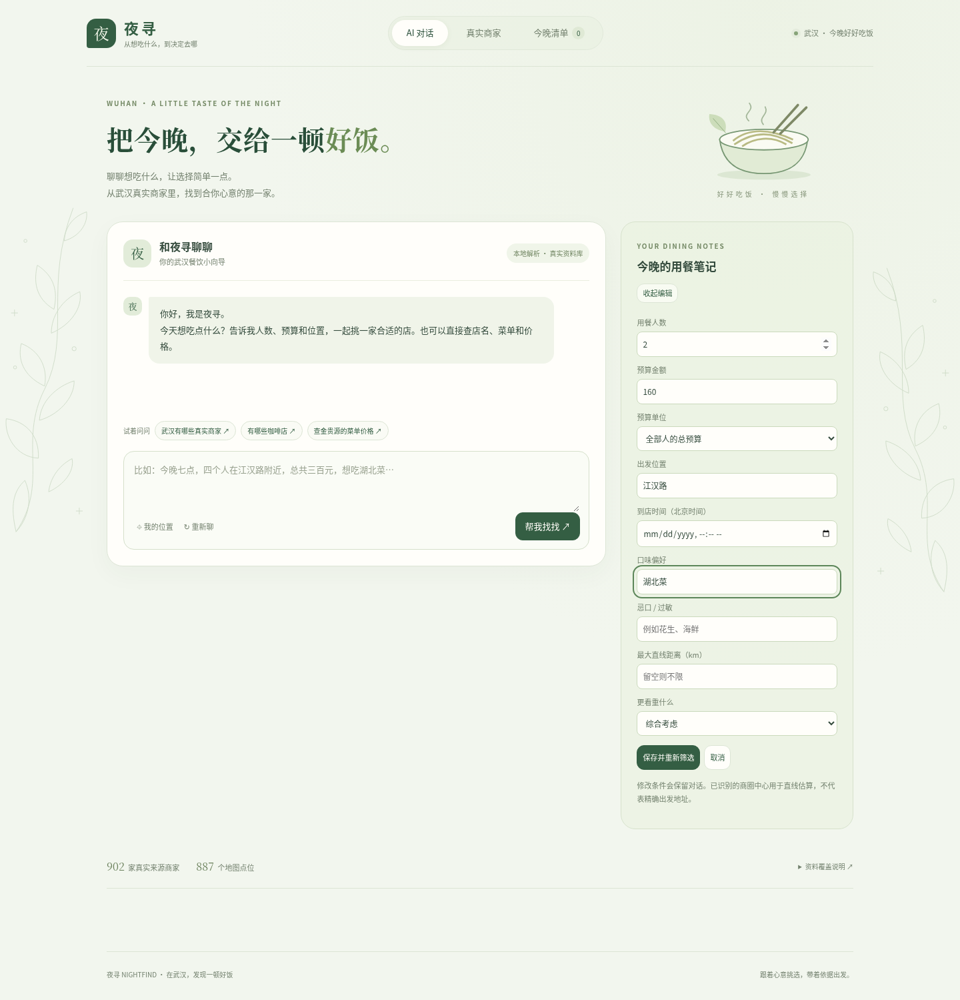
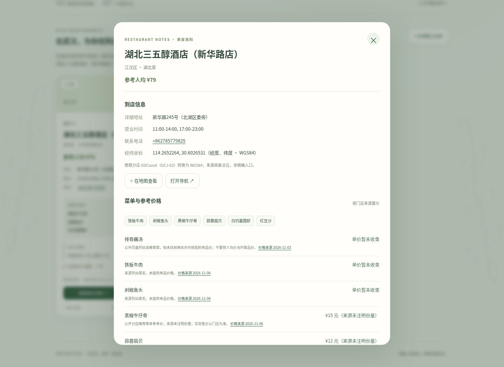

# 本版审核说明 · 2026-11-06

本次分支 `feature/dining-flow-improvements` 完成资料补充、可编辑用餐笔记、会话恢复、局部收藏/对比更新，以及可选国内街道图和步行路线。保持 Python 标准库、SQLite、原生 JavaScript，没有新增运行依赖或构建步骤。

## 数据变化

| 项目             | 上一版 | 本版 |
| ---------------- | -----: | ---: |
| 来源记录         |    889 |  902 |
| 地图坐标点       |    846 |  887 |
| 菜单条目         |     76 |  362 |
| 有来源菜品单价   |     16 |   74 |
| 有单价的门店     |      3 |   21 |
| 其中有坐标的门店 |      0 |   18 |

本次读取 50 个公开分店页面，46 个通过解析。网页门店中 45 家有电话、40 家有营业时段。原有 55 家网页记录保留，增加 13 条真实来源记录；OSM 834 条原始归档不改写。来源记录可能指向同一实体门店，数量不是独立在营门店保证。

菜单、价格、电话和坐标均来自具体分店页面。没有注明份量的菜品价格明确标注“来源未注明份量”，不当作人均价。价格缺失、来源无法读取或分店不符时保留未知。原坐标及使用的事实、原页面 SHA-256 见 `data_sources/wuhan_web_refresh.json`。

## 建议检查

1. Mac 用 `python3 run.py` 启动。也可在终端输入 `python3` 加空格，将解压后的 `run.py` 拖进终端再回车。
2. 输入“查湖北三五醇酒店新华路店的菜单价格”，查看新补充的电话、营业时段、单价及坐标。
3. 点击右侧“编辑条件”，填写人数、预算、位置和时间后保存。候选应重新筛选，对话保留；不支持的位置会留在表单里提示。
4. 输入一段草稿后刷新，检查对话、草稿和条件恢复。资料会重新从后端查询；本机浏览器保存期限为 24 小时，点击“重新聊”可清除。
5. 进入真实商家，缩放地图或滚动到卡片后，收藏、加入对比。地图视野和页面位置应保持；切换页面再回来也会恢复地图视野。
6. 选定有坐标的门店，在已设置出发位置时查询步行路线。默认提供高德外部路线；配置自己的 `AMAP_WEB_KEY` 后，可显示服务返回的距离、用时和地图路线。

## 地图服务配置

- 本地武汉简图始终随项目提供，标准在线街道图默认使用 OSM。
- `.env` 填入 `TIANDITU_KEY` 可优先使用天地图街道与文字注记；失败自动回退。它是浏览器地图 Key，应在服务商控制台限制使用域名。
- `.env` 填入高德 **Web 服务** `AMAP_WEB_KEY` 可查询实际步行路线；此密钥仅在后端使用，不通过配置接口发给浏览器。
- 当前环境没有上述服务密钥。已完成接口和回退实现；服务响应解析、坐标转换、路线显示和错误处理用测试验证。没有把测试路线或估算时间写入真实商家资料，未配置时不展示编造的步行用时。
- 来源坐标集中转换，携程/高德 GCJ-02 不直接混入项目的 WGS84 地图。

## 验证范围

- 91 项 Python 后端、HTTP、数据解析与坐标/路线回归测试通过。
- 3 项浏览器会话存储单元测试通过：有效期、不可用存储、仅保存门店 ID 并重新读取价格。
- Chromium 完整流程：真实菜单与电话、刷新恢复、失败重试、直接编辑条件、未知位置提示、选店导航、路线回退、887 个源点位、收藏/对比不跳动、地图视野恢复。
- 320、390、768、1440 像素宽度检查，无横向溢出或浏览器脚本异常。
- 标准街道图及外部图片阻断时仍显示本地武汉地理数据。天地图失败到 OSM 再到本地层的回退单独验证。

以下截图使用实际数据库；图片和在线地图服务不可访问时显示插画与离线地图，未使用模拟商家或测试路线。

## AI 对话

## 可编辑用餐条件

## 新补充的分店资料

## 武汉地图

## 商家卡片

## 手机页面

